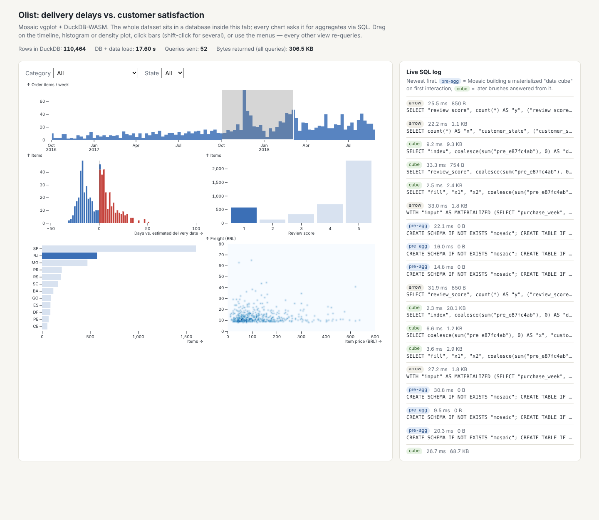

# Query-Driven Visualization: Mosaic, DuckDB and Embedding Atlas

**Proposed CSE 578 topic:** *Scalable visual-analytics systems — how modern tools push
visualization work into a database so that linked, interactive views stay fast at
millions of rows.*

The syllabus teaches **what** linked views, brushing and crossfiltering are (Modules 3-II
and 7) and **which** encodings to choose. It never covers **how a tool makes them work
when the data doesn't fit in the chart library** — the systems layer. That layer has
changed a lot since 2023, and the tools below are the clearest examples:

| Tool | Origin / year | What's new |
|---|---|---|
| **Mosaic + vgplot** | UW Interactive Data Lab — IEEE TVCG 2024 (VIS 2023); Python `vgplot` API is new (0.x) | Every chart is a database client; the coordinator turns selections into SQL and pre-aggregates on demand |
| **DuckDB-WASM** | DuckDB Labs | A full analytical SQL engine running inside the browser tab |
| **Embedding Atlas** | Apple, open-sourced May 2025 (arXiv 2505.06386) | Built on Mosaic; WebGPU rendering of millions of embedding points, auto cluster labels, density contours, nearest-neighbour search |

## How it works

```
 Browser / Jupyter                                  DuckDB (in the tab via WASM,
 ┌──────────────────────────────────────┐           or a Python/Rust server)
 │ timeline  histogram  bars  raster    │  SQL      ┌──────────────────────────┐
 │    │         │        │      │       │ ───────▶  │ orders (1M+ rows)        │
 │    └── clients publish queries ──┐   │           │ mosaic.preagg_* (cubes)  │
 │                                  ▼   │  Arrow    └──────────────────────────┘
 │  Coordinator: selections → WHERE,    │ ◀───────  only aggregates come back
 │  consolidation, cache, pre-aggregate │           (bins, groups, pixel grids)
 └──────────────────────────────────────┘
```

1. **Marks are clients, not renderers of rows.** A histogram declares
   `SELECT bin(delay_days), count(*) … GROUP BY 1`; a density raster declares a 2-D
   binning query. The database does the work; the browser receives a few KB.
2. **Selections are SQL predicates.** Brushing produces a clause such as
   `purchase_week BETWEEN …`. A *crossfilter* selection applies every clause to every view
   except the one that produced it.
3. **Pre-aggregation (data-cube indexes).** On the first interaction, Mosaic materialises
   small tables (`mosaic.preagg_*`) grouped by each view's bins × the active brush's pixel
   bins. Every later brush movement is a cheap lookup on those tables, not a full scan.
4. **Per-pixel reduction.** Line/area marks reduce series to a few points per pixel (M4),
   and rasters/hexbins aggregate to the pixel grid, so payload size tracks the *chart* size,
   not the data size.
5. **One spec, three runtimes.** The same declarative spec runs in Jupyter (DuckDB in the
   kernel), in a static web page (DuckDB-WASM), or against a DuckDB server.

Embedding Atlas is the same architecture with a GPU point renderer on top: the embedding
scatterplot is one more Mosaic client, so selecting a region of "meaning space" filters
the metadata charts and vice versa.

## Working examples (Olist dataset)

Step-by-step demo instructions, with expected output and what to click, are in
**[DEMO.md](DEMO.md)**. The short version:

```bash
# 0. Setup: create and activate a virtual environment, install dependencies
python3 -m venv .venv
source .venv/bin/activate
pip install -r requirements.txt

# 1. Generate synthetic CSVs with the Kaggle Olist file names and columns (English review comments)
#    Use --orders 1000000 for a stress test, or skip this and use the real Kaggle folder in step 2
python generate_synthetic_olist.py --orders 100000

# 2. Join the CSVs with DuckDB SQL → web/orders.parquet and web/reviews.parquet
python prepare_data.py --src data/synthetic

# 3. Example A: export the vgplot dashboard (Python) → web/dashboard.json
python dashboard.py

# 4. Serve the web/ folder, then open http://localhost:8000 (Ctrl+C to stop)
python -m http.server 8000 --directory web
```

**Example A** (`dashboard.py` → `web/index.html`): five linked views over every order item
— weekly volume, delay vs. promised date, review scores, top states, price × freight
density — plus category/state menus. The page loads Mosaic and DuckDB-WASM from jsDelivr
(needs internet) and shows a **live SQL log** with the time and bytes of every query, so
you can watch the architecture work: plain aggregates on load, `pre-agg` tables on the
first brush, then `cube` lookups.


*Timeline brushed to Nov 2017–Mar 2018, 1-star reviews clicked, RJ clicked: the delay
histogram shifts right — late deliveries drive bad reviews. 110k rows; the initial render
returned ~87 KB in total.*

In Jupyter the same view renders via `mosaic-widget`, with DuckDB in the kernel:

```python
import os; os.chdir("web")            # data paths in the spec are relative to web/
import sys; sys.path.insert(0, "..")
from dashboard import view
view                                   # or view.show()
```

**Example B** (`reviews_atlas.py`): embeds every written review (TF-IDF char-n-grams →
SVD → UMAP, no model download) and opens Embedding Atlas:

```bash
# Build web/reviews_xy.parquet (~15 s), then open Embedding Atlas at http://localhost:5055
python reviews_atlas.py

# Alternative: let Embedding Atlas compute neural embeddings itself (downloads a model;
# the multilingual model handles the English synthetic and the Portuguese real comments)
embedding-atlas web/reviews.parquet --text review_text --model paraphrase-multilingual-MiniLM-L12-v2
```

Colour the map by `late` and select the low-score islands: 1–2★ reviews split into a
**delivery-complaint** region (mostly late orders) and a **product-complaint** region
(mostly on-time orders) — two different operational problems behind the same star rating.
The embedding view needs a WebGPU browser (recent Chrome/Edge); its side charts and table
work in any browser.

## Trade-offs worth presenting

- **Everything must be SQL-expressible.** Custom transforms that aren't SQL (some layouts,
  iterative algorithms) need precomputing, as UMAP is here.
- **First interaction pays the cube build.** Fine at 10⁶ rows; at 10⁹ you want a server-side
  DuckDB, not WASM (browser memory caps the in-tab database).
- **Network dependencies.** The static page fetches Mosaic and DuckDB-WASM from jsDelivr and
  DuckDB's Parquet extension from extensions.duckdb.org; for an offline demo, use the Jupyter route.
- **Young APIs.** vgplot's Python API and Embedding Atlas are 0.x releases — pin versions
  (see `requirements.txt` and the import map in `index.html`).
- **Overkill below ~50k rows.** Vega-Lite/Altair shipping raw rows is simpler and fast enough.

## Files

| File | Purpose |
|---|---|
| `DEMO.md` | Step-by-step demo commands, expected output and talking points |
| `generate_synthetic_olist.py` | Writes CSVs with the exact Kaggle Olist file names and columns (English review comments) |
| `prepare_data.py` | DuckDB SQL joins → `orders.parquet` (delivered order items) and `reviews.parquet` |
| `dashboard.py` | Mosaic vgplot dashboard in Python; exports `web/dashboard.json` |
| `web/index.html` | Runs the spec in the browser on DuckDB-WASM, with the live SQL log |
| `reviews_atlas.py` | Review-text projection + Embedding Atlas launcher |

## References

- J. Heer, D. Moritz. *Mosaic: An Architecture for Scalable & Interoperable Data Views.* IEEE TVCG 30(1), 2024. https://idl.uw.edu/mosaic
- D. Ren, F. Hohman, H. Lin, D. Moritz. *Embedding Atlas: Low-Friction, Interactive Embedding Visualization.* arXiv:2505.06386, 2025. https://github.com/apple/embedding-atlas
- vgplot Python API: https://pypi.org/project/vgplot/ · Jupyter widget: https://idl.uw.edu/mosaic/jupyter
- Olist dataset: https://www.kaggle.com/datasets/olistbr/brazilian-ecommerce
